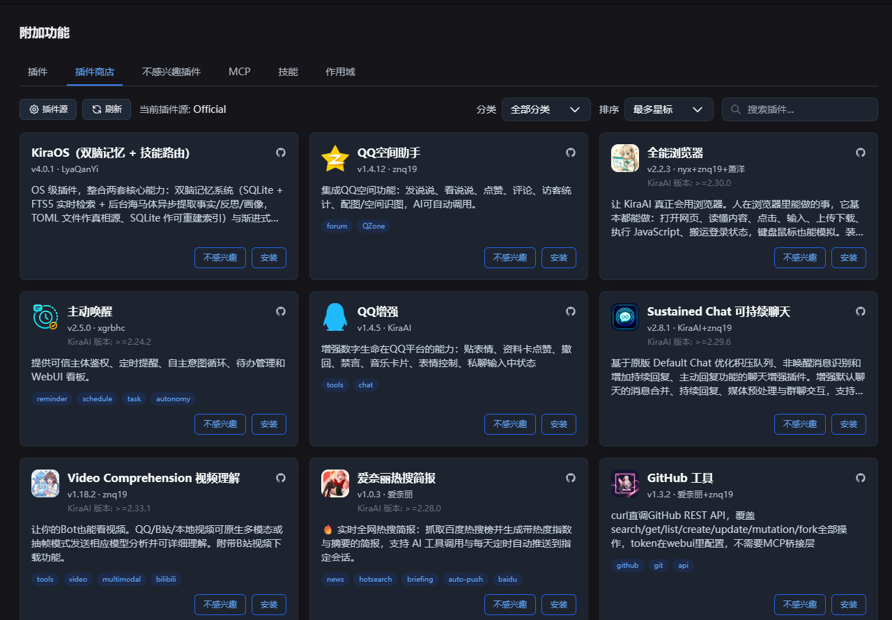

<div align="center">

# 商店净化 · Store Purifier

给 KiraAI 插件商店加一个「不感兴趣」按钮，把不想再看到的插件收进独立标签页。

[](https://github.com/2skr1996-cloud/kira-ai-plugin-store-purifier/releases)
[](LICENSE)
[](https://github.com/KiraAI-Dev/KiraAI)
[](https://github.com/deepseek-ai/deepseek-harness)



</div>

## 功能

| 功能 | 说明 |
| --- | --- |
| **卡片按钮** | 商店每张卡片左侧多一个「不感兴趣」，点一下卡片淡出消失，本页剩余卡片自动上移 |
| **二次确认** | 第一下变成「确认隐藏」，再点才生效；点别处或 4 秒后自动取消 |
| **独立标签页** | 标签栏多一个「不感兴趣插件」，集中收纳已标记的插件，可看详情、取消标记、直接安装 |
| **纯本地** | 名单只存在当前浏览器，不上传、不同步 |

## 安装

1. 把插件目录放进 `data/plugins/kira-ai-plugin-store-purifier/`
2. 重启 KiraAI，或在插件面板里启用
3. 打开「附加功能 → 插件商店」，按钮就出现了

> 加载时会自动写入 `data/dist` 并注入 `index.html`，不需要手动改前端文件。

## 使用

- **隐藏**：点「不感兴趣」→ 再点「确认隐藏」→ 卡片消失
- **恢复**：切到「不感兴趣插件」页 → 点「取消不感兴趣」
- 恢复的插件要等商店下次刷新才会回到列表

## 卸载

停用插件即可，注入会自动移除。名单留在浏览器里（`kira.pluginStore.notInterested.v1`）。

## 命令行（可选）

```bash
python injector.py                 # 手动同步 + 注入
python injector.py --remove        # 移除，恢复原状
python injector.py --dist <dir>    # 指定 dist 目录
```

## 原理

- 启动时把 `web/store-purifier.js` 同步进 `data/dist`，在 `</head>` 前注入带版本号的 `<script>`。
- 官方升级整包覆盖 `data/dist` 时，插件会立刻补回注入，不留空窗。
- 写回 `index.html` 只认合法 UTF-8，原子替换；失败就放弃这一轮，不会写坏页面。

## 已知限制

- 名单按浏览器保存，换浏览器或清缓存会丢。
- 依赖官方 DOM 结构与文案，官方大改版可能需要适配。

## License

[MIT](LICENSE) © 2026 sijun

---

<sub>本项目代码与文档由 AI 生成，人类负责需求与验收。</sub>
